<picture>
  <source media="(prefers-color-scheme: dark)" srcset="./assets/banner-dark.svg">
  <source media="(prefers-color-scheme: light)" srcset="./assets/banner-light.svg">
  
</picture>

  <b>Computer Science student · Developer in progress</b> 
  I learn by building real apps — and by shipping fixes to other people's codebases.

  
  
  
  <!-- Add LinkedIn when ready:
  
  -->

---

## About me

- Second-year Computer Science (CSIT) undergraduate, building my fundamentals in DSA, web development and software design.
- I build full-stack JavaScript apps (React, Express, MongoDB) and Python services on top of AI APIs.
- Team lead on **xSTUDENT** — I plan the work as GitHub issues, review my team's pull requests and merge them.
- Contributing to open source: my first pull requests have been merged into **hiero-sdk-js**, **BrighterScript** and **Tabularis**.
- Open to collaborating on projects and to internship opportunities.

## Current focus

<!-- Keep this short and update it every few weeks. -->

- **Open source** — feature PR under review in [jaegertracing/jaeger-ui](https://github.com/jaegertracing/jaeger-ui/pull/4555).
- **DockLeaf** — team minor project: an AI-assisted green supply-chain optimizer that recommends warehouses and routes by cost, time and CO₂ (Python + MongoDB).
- **Learning** — TypeScript in real codebases, low-level design, and DSA practice in C++.

## Tech stack

| | Using | Learning |
|---|---|---|
| **Languages** |  |  |
| **Frontend** |  · EJS | |
| **Backend** |  | |
| **Data & AI** |  · Mongoose · Gemini API | |
| **Tooling** |  · Render · pytest | |

## Featured projects

### [xSTUDENT](https://github.com/princecherry9905/xSTUDENT) &nbsp;team project · team lead

A full-stack student management system built by a four-person team.

- **What it shows:** role-based access (admin vs. user), protected routes, paginated and filterable student records, centralised error handling, a health-check endpoint and an integration test suite.
- **Stack:** React 19 · Vite · React Router · Bootstrap 5 · Node.js · Express 5 · Mongoose · MongoDB Atlas
- **Links:** [Repository](https://github.com/princecherry9905/xSTUDENT) · [API on Render](https://xstudent.onrender.com/api/health) · [Frontend on Vercel](https://x-student.vercel.app) (deployment in progress)

### [ProfessorAI](https://github.com/princecherry9905/professor-ai) &nbsp;personal project

An AI tutor for college subjects (DSA, OS, DBMS, CN, ML and more) with seven answer modes — from one-word answers to step-by-step lessons and graded quizzes.

- **What it shows:** a FastAPI backend wrapping Google Gemini, validated JSON output with retry, Pydantic models, and 86 tests that run against a fake provider so no API key is needed.
- **Stack:** Python · FastAPI · Pydantic v2 · Gemini API · Jinja2 · vanilla JS · pytest
- **Links:** [Repository](https://github.com/princecherry9905/professor-ai) (runs locally)

### [EcoLoop](https://github.com/princecherry9905/-2-assigment-) &nbsp;course project

An e-waste pickup and recycling platform connecting citizens, collection agents and recyclers.

- **What it shows:** three user roles with session auth, an 8-step pickup lifecycle, live status updates over Server-Sent Events, and a points-based rewards wallet.
- **Stack:** Node.js · Express (MVC) · EJS · MongoDB · Mongoose · bcrypt
- **Links:** [Repository](https://github.com/princecherry9905/-2-assigment-) · [Live demo](https://ecoloop-eight.vercel.app)

## Open-source contributions

| Project | Pull request | Status |
|---|---|---|
| [hiero-ledger/hiero-sdk-js](https://github.com/hiero-ledger/hiero-sdk-js) | [Unit tests for `SemanticVersion`](https://github.com/hiero-ledger/hiero-sdk-js/pull/4469) | ✅ Merged |
| [rokucommunity/brighterscript](https://github.com/rokucommunity/brighterscript) | [`bsc --init` to scaffold a `bsconfig.json`](https://github.com/rokucommunity/brighterscript/pull/1892) | ✅ Merged |
| [TabularisDB/tabularis](https://github.com/TabularisDB/tabularis) | [Respect UI language in AI “Explain” auto mode](https://github.com/TabularisDB/tabularis/pull/1026) | ✅ Merged |
| [TabularisDB/tabularis](https://github.com/TabularisDB/tabularis) | [`create-plugin --with-ui` adds `ui_extensions` to the manifest](https://github.com/TabularisDB/tabularis/pull/1053) | ✅ Merged |
| [jaegertracing/jaeger-ui](https://github.com/jaegertracing/jaeger-ui) | [Outline the current Find match in the trace timeline](https://github.com/jaegertracing/jaeger-ui/pull/4555) | 🔄 In review |

## Activity

  <picture>
    <source media="(prefers-color-scheme: dark)" srcset="https://streak-stats.demolab.com/?user=princecherry9905&background=0B1120&border=1E293B&stroke=1E293B&ring=22D3EE&fire=A78BFA&currStreakNum=F8FAFC&sideNums=F8FAFC&currStreakLabel=22D3EE&sideLabels=94A3B8&dates=64748B&border_radius=12">
    
  </picture>

<picture>
  <source media="(prefers-color-scheme: dark)" srcset="https://raw.githubusercontent.com/princecherry9905/princecherry9905/output/github-snake-dark.svg">
  
</picture>

No language-percentage card here on purpose: most of my recent code lives in pull requests to other projects, which per-repo language stats don't count.

---

  Small commits, real reviews, merged code — and always one more thing to learn. 
  Working on something interesting? Open an issue on any of my repos — I read them.

